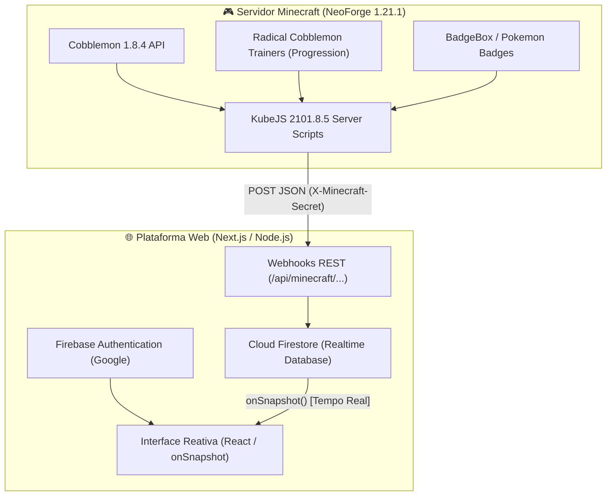

# 🌐 Firma League - Especificação Técnica de Integração Web (Cobblemon ⇄ Firebase)

Este documento foi elaborado para desenvolvedores e agentes de IA (como Cloud Coder / Claude Code) implementarem a ponte de sincronização entre o servidor de **Minecraft (Firma League / Cobblemon 1.21.1)** e a **Plataforma Web (Firebase Auth + Cloud Firestore)**.

---

## 🏗️ 1. Arquitetura da Solução



---

## 🔐 2. Autenticação e Segurança entre Servidor e Web
Todas as requisições enviadas do Minecraft para a API do site carregam um cabeçalho HTTP de segurança:
```http
X-Minecraft-Secret: <SUA_CHAVE_SECRETA_CONFIGURADA_NO_ENV>
Content-Type: application/json
```
O backend web deve validar esse header antes de processar qualquer webhook.

---

## 🎟️ 3. Fluxo de Vinculação de Conta (OTP Token)

### Como funciona:
1. Jogador entra no Minecraft e digita `/vincular`.
2. Servidor gera um código alfanumérico curto (ex: `FIRMA-8K2P`), com validade de 15 minutos.
3. O servidor envia uma requisição para a rota `POST /api/minecraft/link/create`:
   ```json
   {
     "token": "FIRMA-8K2P",
     "minecraft_uuid": "d94721b0-7454-4d13-a691-d76a9c40cf4c",
     "minecraft_nick": "AshKetchum",
     "expires_at": 1793990000000
   }
   ```
4. O usuário entra no site, faz login com Google (Firebase Auth), vai até o perfil e digita o token `FIRMA-8K2P`.
5. A aplicação web verifica se o token existe em `link_tokens/{token}` e não expirou:
   * Associa `minecraft_uuid` e `minecraft_nick` no documento `users/{uid}`.
   * Remove o documento temporário `link_tokens/{token}`.
6. A partir desse instante, a conta está vinculada.

---

## 📊 4. Schema de Dados do Jogador no Firestore (`players/{minecraft_uuid}`)

O servidor Minecraft envia periodicamente (ao conectar, desconectar, após capturas e conquistas de insígnias) um payload para `POST /api/minecraft/sync/player`.

```json
{
  "uuid": "d94721b0-7454-4d13-a691-d76a9c40cf4c",
  "nick": "AshKetchum",
  "level_cap": 20,
  "current_series": "kanto",
  "badges": [
    {
      "id": "boulder_badge",
      "name": "Boulder Badge",
      "region": "kanto",
      "obtained_at": "2026-11-06T18:00:00Z"
    },
    {
      "id": "cascade_badge",
      "name": "Cascade Badge",
      "region": "kanto",
      "obtained_at": "2026-11-06T18:30:00Z"
    }
  ],
  "pokedex": {
    "seen_count": 85,
    "caught_count": 42,
    "total_species": 1025,
    "completion_percentage": 4.1,
    "seen_pokemon": ["bulbasaur", "ivysaur", "charmander", "charmeleon", "pikachu"],
    "caught_pokemon": ["charmander", "pikachu"]
  },
  "party": [
    {
      "slot": 1,
      "species": "pikachu",
      "nickname": "Sparky",
      "level": 20,
      "is_shiny": true,
      "gender": "MALE",
      "ability": "Static",
      "nature": "Timid",
      "held_item": "light_ball",
      "moves": [
        { "name": "Thunderbolt", "type": "electric" },
        { "name": "Quick Attack", "type": "normal" },
        { "name": "Iron Tail", "type": "steel" },
        { "name": "Thunder Wave", "type": "electric" }
      ],
      "ivs": { "hp": 31, "atk": 12, "def": 28, "spa": 31, "spd": 25, "spe": 31 },
      "evs": { "hp": 0, "atk": 0, "def": 4, "spa": 252, "spd": 0, "spe": 252 }
    }
  ],
  "updated_at": "2026-11-06T18:30:00Z"
}
```

---

## 🏆 5. Sistema de Torneios com Placar ao Vivo

### Estrutura do Torneio (`tournaments/{tournament_id}`):
```json
{
  "id": "torneio-inauguracao-01",
  "title": "Torneio Cerulean Cup",
  "status": "in_progress", // upcoming | in_progress | completed
  "format": "single_elimination",
  "rounds_total": 3,
  "matches": [
    {
      "match_id": "r1_m1",
      "round": 1,
      "player1": { "uuid": "uuid_1", "nick": "PlayerOne" },
      "player2": { "uuid": "uuid_2", "nick": "PlayerTwo" },
      "winner_uuid": null,
      "score": null,
      "status": "in_progress" // pending | in_progress | completed
    }
  ]
}
```

### Webhook de Resultado de Partida (`POST /api/minecraft/tournament/match-result`):
Quando dois jogadores terminam uma batalha PvP de torneio dentro do Minecraft, o KubeJS detecta o vencedor e manda:
```json
{
  "tournament_id": "torneio-inauguracao-01",
  "match_id": "r1_m1",
  "winner_uuid": "uuid_1",
  "loser_uuid": "uuid_2",
  "score": "6-4",
  "duration_seconds": 184
}
```
O backend atualiza a partida no Firestore. Como a página do torneio no frontend usa `onSnapshot`, a chave atualiza e move o vencedor para a próxima fase **instantaneamente**!

---

## 💻 6. Exemplo de Implementação KubeJS (Lado Servidor Minecraft)

O arquivo `kubejs/server_scripts/web_sync_bridge.js` utiliza a API Java `java.net.http.HttpClient` nativa do Java 21 para disparar webhooks sem congelar a thread do servidor:

```javascript
// Exemplo de envio assíncrono em KubeJS
const HttpClient = Java.loadClass('java.net.http.HttpClient');
const HttpRequest = Java.loadClass('java.net.http.HttpRequest');
const HttpResponse = Java.loadClass('java.net.http.HttpResponse');
const URI = Java.loadClass('java.net.URI');

function sendWebhook(endpoint, payload) {
    let client = HttpClient.newHttpClient();
    let jsonBody = JSON.stringify(payload);
    let request = HttpRequest.newBuilder()
        .uri(URI.create("https://seu-site.vercel.app/api/minecraft/" + endpoint))
        .header("Content-Type", "application/json")
        .header("X-Minecraft-Secret", "SEU_TOKEN_SECRETO")
        .POST(HttpRequest.BodyPublishers.ofString(jsonBody))
        .build();

    client.sendAsync(request, HttpResponse.BodyHandlers.ofString());
}
```

---

## 🛡️ 7. Regras de Segurança do Firestore (`firestore.rules`)
```javascript
rules_version = '2';
service cloud.firestore {
  match /databases/{database}/documents {
    
    // Perfil do Usuário
    match /users/{userId} {
      allow read: if true;
      allow write: if request.auth != null && request.auth.uid == userId;
    }
    
    // Dados sincronizados do Minecraft (apenas backend com admin SDK ou leitura pública)
    match /players/{playerId} {
      allow read: if true;
      allow write: if false; // Apenas a API com Admin SDK pode escrever
    }
    
    // Torneios
    match /tournaments/{tournamentId} {
      allow read: if true;
      allow write: if false; // Apenas a API com Admin SDK pode escrever
    }
  }
}
```
