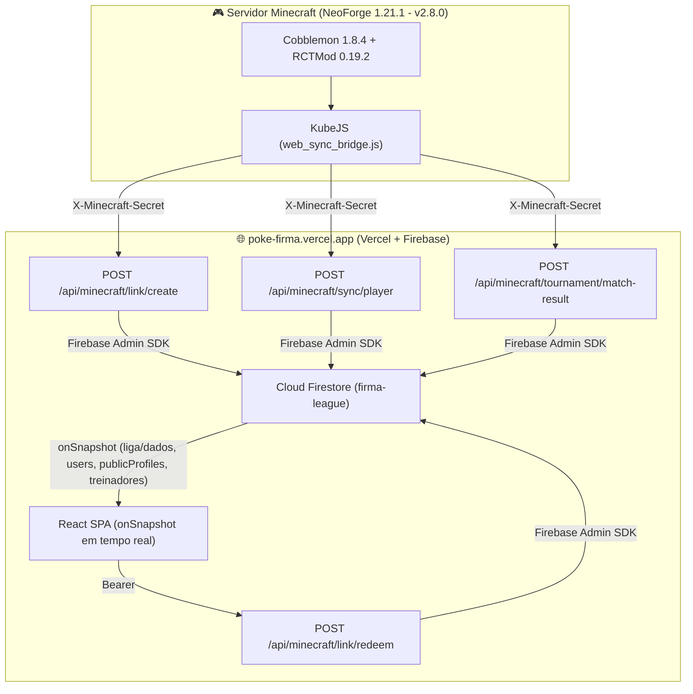

# 🌐 Firma League - Especificação Técnica de Integração Web (`poke-firma.vercel.app` ⇄ Minecraft v2.8.0)

Este documento mapeia a integração em tempo real já **em produção** entre o servidor de **Minecraft (Firma League v2.8.0 / Cobblemon 1.8.4 NeoForge 1.21.1)** e a plataforma web oficial **[poke-firma.vercel.app](https://poke-firma.vercel.app/)** (Vite + React + Vercel Serverless Functions + Firebase Project `firma-league`).

---

## 🏗️ 1. Arquitetura em Produção (`poke-firma.vercel.app`)

A plataforma web é uma **SPA em Vite + React** hospedada na **Vercel**, conectada ao projeto Firebase **`firma-league`** e alimentada em tempo real por **4 Vercel Serverless Functions** autenticadas via header `X-Minecraft-Secret` (ou `POST /api/minecraft/link/redeem` autenticado via Firebase Auth ID Token):

### Coleções do Cloud Firestore:
1. **`liga/dados`** *(Documento global escutado em tempo real via `onSnapshot` pelo `LigaProvider`)*:
   - Guarda `jogadores` (ranking geral com `nick`, `trainer_id`, `minecraft_uuid`, `pontos`, `vitorias`, `derrotas`, `titulos`) e `torneios` (Copas Kanto, Johto, Hoenn e Sinnoh, incluindo `formatoGrupos: "MD1" | "MD3"`, `formatoMataMata: "MD1" | "MD3"`, `inscritos`, `grupos` e `chave` de partidas).
2. **`liga/meta`** *(Controle transacional de sequência)*:
   - Mantém o contador atômico `next_trainer_seq` para emissão de `Trainer ID` único (`TR-001`, `TR-002`...).
3. **`users/{uid}`** *(Documento privado do usuário logado via Google Auth, escutado via `onSnapshot`)*:
   - Campos de vinculação (`verificado`, `trainer_id`, `minecraft_uuid`, `nick`, `capitulo`, `level_cap`, `insignias`) são protegidos pelas Security Rules (somente o Admin SDK via Vercel Functions pode alterá-los).
4. **`publicProfiles/{nick_lowercase}`** *(Perfil público buscável em `/jogadores` e `/jogador/:nick`, escutado via `onSnapshot`)*:
   - Espelha os dados públicos do treinador e seu `minecraft_uuid` para carregar a ficha ao vivo do servidor.
5. **`treinadores/{minecraft_uuid}`** *(Documento exclusivo gravado pelo servidor Minecraft via `/api/minecraft/sync/player`, escutado via `onSnapshot`)*:
   - Contém `uuid`, `nick`, `capitulo`, `level_cap`, `insignias`, `pokedex` (`vistos`, `capturados`, `total_vistos`, `total_capturados`), `party` (6 Pokémon ativos com ficha completa) e `pc` (todos os Pokémon guardados nas Boxes do PC).
6. **`linkTokens/{token}`** *(Coleção privada acessível somente pelo Firebase Admin SDK)*:
   - Guarda os códigos temporários gerados pelo comando `/vincular` no Minecraft (uso único, validade de 1 hora).



---

## 🎟️ 2. Vinculação de Conta (`/vincular`) & `Trainer ID` (`TR-001`)

### Fluxo Completo:
1. O jogador entra no servidor Minecraft e digita **`/vincular`**.
2. O script KubeJS (`kubejs/server_scripts/web_sync_bridge.js`) gera um código de 6 caracteres (ex: `FIRMA-8K2P`), envia uma requisição para `POST https://poke-firma.vercel.app/api/minecraft/link/create` com o header `X-Minecraft-Secret` e também já dispara um sync inicial dos dados do jogador:
   ```json
   {
     "token": "FIRMA-8K2P",
     "minecraft_uuid": "d94721b0-7454-4d13-a691-d76a9c40cf4c",
     "minecraft_nick": "Mayronsf",
     "expires_at": 1793990000000
   }
   ```
3. No site (`/perfil` ou janela de boas-vindas), o jogador logado com Google cola o código (aceita com ou sem o prefixo `FIRMA-` e em maiúsculas/minúsculas).
4. O frontend chama `POST /api/minecraft/link/redeem` enviando `{ "token": "FIRMA-8K2P" }` e `Authorization: Bearer <idToken>`.
5. A função valida o token em transação atômica, atribui o **`trainer_id`** sequencial (`TR-001`, `TR-002`...), migra o perfil público para o nick real do Minecraft, trava a edição manual de nick/insígnias no site e cadastra o jogador na lista da Liga.

---

## 🏅 3. Sincronização em Tempo Real do Treinador (`POST /api/minecraft/sync/player`)

### Gatilhos Automáticos no Servidor (`web_sync_bridge.js`):
O KubeJS sincroniza automaticamente os dados do jogador (com debounce anti-spam) quando:
- O jogador entra (`PlayerEvents.loggedIn`) ou sai (`PlayerEvents.loggedOut`) do servidor;
- O jogador captura um Pokémon (`CobblemonEvents.POKEMON_CAPTURED`), evolui (`EVOLUTION_COMPLETE`), choca um ovo (`HATCH_EGG_POST`) ou vence/termina uma batalha (`BATTLE_VICTORY` / `BATTLE_FAINTED`);
- O jogador executa `/vincular` ou `/sincronizar`.

### IDs Oficiais de Insígnias (`BadgeCase`):
- **Kanto (Cap. 1):** `"kanto-1"` a `"kanto-8"`, `"kanto-elite"`, `"kanto-campeao"`
- **Johto (Cap. 2):** `"johto-1"` a `"johto-8"`, `"johto-elite"`, `"johto-campeao"`
- **Hoenn (Cap. 3):** `"hoenn-1"` a `"hoenn-8"`, `"hoenn-elite"`, `"hoenn-campeao"`
- **Sinnoh (Cap. 4):** `"sinnoh-1"` a `"sinnoh-8"`, `"sinnoh-elite"`, `"sinnoh-campeao"`

### Payload Completo (`POST /api/minecraft/sync/player`):
```json
{
  "uuid": "d94721b0-7454-4d13-a691-d76a9c40cf4c",
  "nick": "Mayronsf",
  "capitulo": 1,
  "level_cap": 27,
  "insignias": ["kanto-1", "kanto-2"],
  "pokedex": {
    "vistos": [1, 4, 7, 25, 94, 130],
    "capturados": [1, 25, 94],
    "total_vistos": 6,
    "total_capturados": 3
  },
  "party": [
    {
      "dex": 25,
      "especie": "pikachu",
      "forma": null,
      "apelido": "Sparky",
      "nivel": 25,
      "sexo": "M",
      "shiny": true,
      "habilidade": "static",
      "natureza": "timid",
      "item": "light_ball",
      "tera": "electric",
      "golpes": ["thunderbolt", "quick-attack", "iron-tail", "thunder-wave"],
      "ivs": { "hp": 31, "atk": 12, "def": 28, "spa": 31, "spd": 25, "spe": 31 },
      "evs": { "hp": 0, "atk": 0, "def": 4, "spa": 252, "spd": 0, "spe": 252 }
    }
  ],
  "pc": [
    {
      "caixa": 1,
      "slot": 1,
      "dex": 130,
      "especie": "gyarados",
      "forma": null,
      "apelido": "Leviathan",
      "nivel": 24,
      "sexo": "M",
      "shiny": false,
      "habilidade": "intimidate",
      "natureza": "adamant",
      "item": "leftovers",
      "tera": "flying",
      "golpes": ["waterfall", "dragon-dance", "ice-fang", "crunch"],
      "ivs": { "hp": 29, "atk": 31, "def": 24, "spa": 10, "spd": 22, "spe": 31 },
      "evs": { "hp": 4, "atk": 252, "def": 0, "spa": 0, "spd": 0, "spe": 252 }
    }
  ]
}
```

---

## 🏆 4. Resultados Automáticos de Torneios (`POST /api/minecraft/tournament/match-result`)

Quando uma batalha PvP (`battle.isPvP()`) termina no servidor Minecraft, o script `web_sync_bridge.js` identifica o vencedor e o perdedor, calcula os KOs e os 6 Pokémon de cada equipe, e envia para `POST /api/minecraft/tournament/match-result`:

```json
{
  "battle_id": "a1b2c3d4-e5f6-7890-abcd-ef1234567890",
  "winner_uuid": "uuid_do_vencedor",
  "loser_uuid": "uuid_do_perdedor",
  "ko_winner": 6,
  "ko_loser": 4,
  "team_winner_dex": [94, 130, 65, 112, 3, 59],
  "team_loser_dex": [248, 212, 181, 197, 230, 214]
}
```
- **Idempotência por `battle_id`:** O UUID único da batalha do Cobblemon (`battle.getBattleId()`) garante que um mesmo duelo nunca seja contabilizado duas vezes.
- **Suporte a `MD1` e `MD3`:** A API verifica o formato configurado para a fase atual (`formatoGrupos` ou `formatoMataMata`), incrementa a série (`jogos`) e, ao atingir o número de vitórias necessário (1 na MD1 ou 2 na MD3), fecha a partida, soma **+3 pontos** e **+1 vitória** no ranking e, se for a Grande Final, coroa automaticamente o **Campeão**.

---

## 🔑 5. Configuração do Segredo no Servidor Minecraft

Para ativar a comunicação do servidor Minecraft com o site:
1. Abra o arquivo [`kubejs/config/web_sync.json`](../kubejs/config/web_sync.json) no servidor (ou defina a variável de ambiente `MINECRAFT_SECRET` no painel da host).
2. Preencha o campo `"secret"` com o mesmo valor de `MINECRAFT_SECRET` cadastrado na Vercel:
   ```json
   {
     "enabled": true,
     "api_base_url": "https://poke-firma.vercel.app",
     "secret": "COLE_AQUI_O_SEU_MINECRAFT_SECRET"
   }
   ```
3. Execute `/reload` no servidor (ou reinicie). O comando `/vincular`, `/sincronizar` e os eventos automáticos já estarão funcionando!
