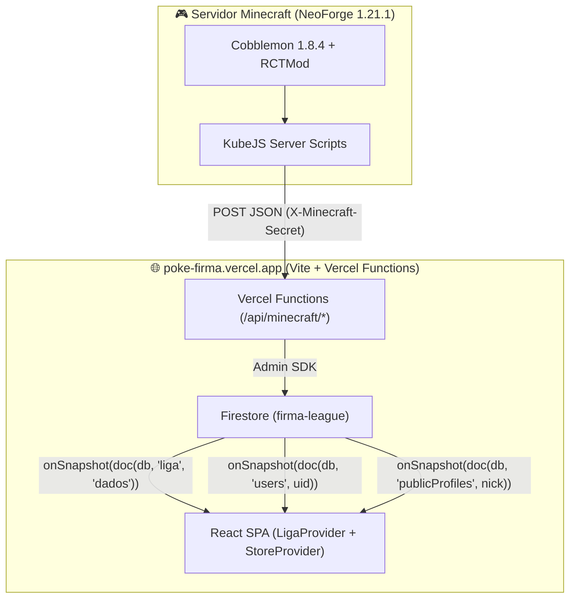

# 🌐 Firma League - Especificação Técnica de Integração Web (`poke-firma.vercel.app` ⇄ Minecraft)

Este documento mapeia a integração em tempo real entre o servidor de **Minecraft (Firma League / Cobblemon 1.21.1 NeoForge)** e a plataforma web oficial **[poke-firma.vercel.app](https://poke-firma.vercel.app/)** (Vite + React + Firebase Project `firma-league`).

---

## 🏗️ 1. Arquitetura Atual do Site (`poke-firma.vercel.app`) & Como Integrar

O site atual é uma **SPA em Vite + React** hospedada na **Vercel**, conectada ao projeto Firebase **`firma-league`** e estruturada sobre as seguintes coleções do **Cloud Firestore**:

1. **`liga/dados`** *(Documento único escutado em tempo real via `onSnapshot` pelo `LigaProvider`)*:
   - Guarda `jogadores` (ranking geral) e `torneios` (Copas Kanto, Johto, Hoenn e Grande Final, incluindo `inscritos`, `grupos` e `chave` de partidas).
2. **`users/{uid}`** *(Documento do usuário logado via Google Auth)*:
   - Guarda `{ nick, bio, favorito, capitulo, insignias, skin, timePrincipal, perfilPublico }` e a subcoleção `users/{uid}/teams/{teamId}`.
3. **`publicProfiles/{nick_lowercase}`** *(Perfil público buscável em `/jogadores` e `/jogador/:nick`)*:
   - Espelha os dados públicos do treinador para busca rápida e autocompletar.
4. **`admins/{uid}`** *(Controle de acesso ao `/admin` — Painel da Liga)*.

### Como adicionar os Webhooks na Vercel (Vite SPA):
Como o projeto utiliza Vite na Vercel, crie uma pasta **`/api/minecraft/`** na raiz do repositório web utilizando **Vercel Serverless Functions** com `firebase-admin` para processar os webhooks vindos do KubeJS do servidor Minecraft.



---

## 🎟️ 2. Vinculação de Conta via Token (`/vincular`) & Geração do `trainer_id`

### Problema que resolve no site atual:
Atualmente, no componente de onboarding (`<dialog className="onboard">`) e no formulário de `/perfil`, o usuário digita qualquer nick manualmente no campo `Nick do Minecraft` e marca as próprias insígnias clicando nelas (`onToggle`).
Com o token:
1. O jogador entra no servidor Minecraft e digita `/vincular`.
2. O servidor gera um código de 6 caracteres (ex: `FIRMA-8K2P`) e envia para `POST https://poke-firma.vercel.app/api/minecraft/link/create`:
   ```json
   {
     "token": "FIRMA-8K2P",
     "minecraft_uuid": "d94721b0-7454-4d13-a691-d76a9c40cf4c",
     "minecraft_nick": "Mayronsf",
     "expires_at": 1793990000000
   }
   ```
3. No site (`/perfil` ou no modal de onboarding), o usuário logado com Google insere o token `FIRMA-8K2P`.
4. A validação do token:
   - Gera automaticamente um **Trainer ID único** (ex: `TR-001`, `TR-002`, usando um contador em `liga/meta` ou sequencial).
   - Salva em `users/{uid}` e em `publicProfiles/{nick_lowercase}`:
     ```json
     {
       "nick": "Mayronsf",
       "trainer_id": "TR-001",
       "minecraft_uuid": "d94721b0-7454-4d13-a691-d76a9c40cf4c",
       "verificado": true
     }
     ```
   - Trava a edição manual de `nick` e o clique manual nas `insignias` (que passam a vir sincronizadas do servidor!).
   - Opcionalmente já adiciona o jogador na lista `jogadores` dentro de `liga/dados` com `{ nick: "Mayronsf", trainer_id: "TR-001", uuid: "d94721b0-...", pontos: 0, vitorias: 0, derrotas: 0, titulos: [] }`.

---

## 🏅 3. Sincronização em Tempo Real do Perfil, Insígnias, Party e Pokédex

### Compatibilidade com os IDs de Insígnias do `BadgeCase` atual:
No código atual do site (`Profile.js`), o componente `BadgeCase` usa exatamente estes IDs para as insígnias:
- **Kanto (Cap. 1):** `"kanto-1"` a `"kanto-8"`, `"kanto-elite"`, `"kanto-campeao"`
- **Johto (Cap. 2):** `"johto-1"` a `"johto-8"`, `"johto-elite"`, `"johto-campeao"`
- **Hoenn (Cap. 3):** `"hoenn-1"` a `"hoenn-8"`, `"hoenn-elite"`, `"hoenn-campeao"`
- **Sinnoh (Cap. 4):** `"sinnoh-1"` a `"sinnoh-8"`, `"sinnoh-elite"`, `"sinnoh-campeao"`

### Payload de Sincronização (`POST /api/minecraft/sync/player`):
O servidor Minecraft envia os dados já mapeados para o formato do site:
```json
{
  "uuid": "d94721b0-7454-4d13-a691-d76a9c40cf4c",
  "nick": "Mayronsf",
  "capitulo": 1,
  "level_cap": 25,
  "insignias": ["kanto-1", "kanto-2"],
  "pokedex": {
    "vistos": [1, 4, 7, 25, 94, 130],
    "capturados": [1, 25, 94],
    "total_vistos": 6,
    "total_capturados": 3
  },
  "party": [
    {
      "dex": 25,
      "especie": "pikachu",
      "apelido": "Sparky",
      "nivel": 25,
      "shiny": true,
      "habilidade": "static",
      "natureza": "Timid",
      "item": "Light Ball",
      "golpes": ["thunderbolt", "quick-attack", "iron-tail", "thunder-wave"],
      "ivs": { "hp": 31, "atk": 12, "def": 28, "spa": 31, "spd": 25, "spe": 31 },
      "evs": { "hp": 0, "atk": 0, "def": 4, "spa": 252, "spd": 0, "spe": 252 }
    }
  ]
}
```
> **No Frontend (`StoreProvider` e `PlayerPublic.js`):**
> - Trocar o `getDoc(doc(db, "users", y.uid))` e `getDoc(doc(db, "publicProfiles", nick))` por **`onSnapshot`** para que, quando o jogador ganhe uma insígnia ou capture um Pokémon no servidor, a tela `/perfil` e `/jogador/:nick` brilhem e atualizem na mesma hora sem precisar dar F5!

---

## 🏆 4. Painel da Liga (`/admin`) & Torneios com `trainer_id` e Placar Automático

### Como o `/admin` funciona hoje:
- Na aba **Jogadores**, existe um `<input list="perfis-cadastrados">` que busca de `publicProfiles`.
- Na aba **Torneios**, o componente `xe` inscreve jogadores puxando de `r.jogadores` (ranking) e cria partidas em `t.chave` no formato:
  `{ fase: "Grupos" | "Semifinal" | "Final", grupo: "A", a: "NickA", b: "NickB", pa: 0, pb: 0, placar: null, koA: 0, koB: 0, timeA: [dex...], timeB: [dex...] }`.

### Melhorias a implementar no `/admin`:
1. **Cadastro de Jogadores por Seletor Vinculado (`trainer_id` + `uuid`):**
   - Na aba **Jogadores** e na inscrição do **Torneio**, em vez de digitação livre de texto, exibir um Seletor/Autocomplete dos jogadores que já vincularam o token no perfil:
     `[ 🔍 Mayronsf | ID: TR-001 (Verificado ✓) ]`.
   - Salvar em `liga/dados -> jogadores` e em `torneios -> inscritos` os campos `{ nick, trainer_id, uuid }`.
2. **Automação de Resultados de Partida (`POST /api/minecraft/tournament/match-result`):**
   - Quando dois jogadores inscritos numa partida aberta (`placar === null`) batalham no Minecraft, o KubeJS envia ao fim da luta:
     ```json
     {
       "torneio_id": "copa-kanto",
       "winner_uuid": "uuid_do_vencedor",
       "loser_uuid": "uuid_do_perdedor",
       "ko_winner": 6,
       "ko_loser": 4,
       "team_winner_dex": [94, 130, 65, 112, 3, 59],
       "team_loser_dex": [248, 212, 181, 197, 230, 214]
     }
     ```
   - A API localiza a partida correspondente em `liga/dados -> torneios`, atualiza `pa` / `pb`, `placar`, `koA` (`ko_winner`), `koB` (`ko_loser`), `timeA` e `timeB`, e soma automaticamente `+3 pontos` e `+1 vitória` no ranking de `liga/dados`!
   - Como o site **já usa `onSnapshot(doc(db, "liga", "dados"))`**, a tabela de grupos, o saldo de KOs, os sprites dos times usados e o chaveamento atualizam ao vivo na tela de todo mundo!

---

## 🔧 5. Pequenos Ajustes de Conteúdo Detectados no Site Atual
Ao analisar o bundle atual de `poke-firma.vercel.app`, notamos alguns detalhes que podem ser atualizados no código do site:
1. **Versão do Modpack (`Q.modpack`):** Atualizar de `2.7.0` (122 mods) para **`2.8.0`** (**130 mods no cliente** / **115 no servidor**).
2. **Texto da Engenharia na página `/lore` (`Ns` e `Ss`):** Na página `/lore`, os textos da seção *"Engenharia da Firma"* ainda citam `Tech Reborn` e `Powah! ReFabric` (da época do rascunho em Fabric), enquanto a página `/mods` já lista corretamente **Mekanism, Create, Powah! e Applied Energistics 2** (NeoForge). Vale alinhar os nomes dos itens-chave na `/lore` para `Mekanism` e `Create`!
3. **Level Caps na página `/liga` (`Q.levelCaps`):** Atualmente estão como `null` (`[A DEFINIR]`). Podem ser preenchidos com os tetos das 4 temporadas:
   - `1` (Kanto): `60` (Início no Nv. 15 → Brock Nv. 15 → Misty Nv. 27 → ... → Campeão Blue Nv. 60)
   - `2` (Johto): `75`
   - `3` (Hoenn): `90`
   - `4` (Sinnoh): `100`
